# Medical Appointment Booking System

**MediBook** is a MERN stack web application for a small clinic. Front-desk staff manage **doctors** and their weekly schedules, register **patients**, and book **appointments** into free time slots without double booking.

EC4307 Web Application Development - Mini Project  
Author: Heshan Praveen ([@kavihesh](https://github.com/kavihesh))

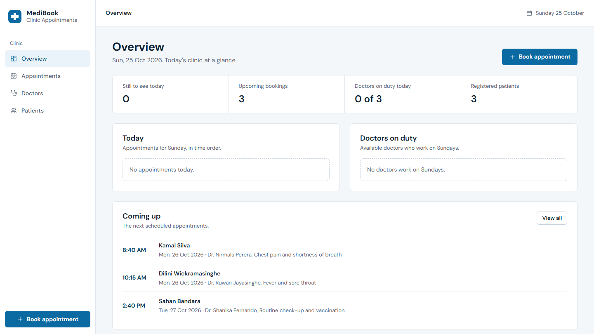

## How the app is used

1. **Add a doctor**: specialty, SLMC registration number, contact details, working days, hours, time per patient and consultation fee.
2. **Register a patient**: name, NIC number, date of birth, gender, contact details, blood group and allergies.
3. **Book an appointment**: search for the patient, choose a doctor and a date, then pick one of the free time slots. Booked and past times are crossed out and cannot be chosen.

The Overview page shows today's appointments, the doctors on duty today and the next bookings. A short guide appears there until all three steps have been done once.

## Features

| Area | What you can do |
|---|---|
| **Create** | Add doctors, register patients and book appointments with sectioned forms that check every field as you type and show a message under each field that needs fixing |
| **Read** | Lists with **search**, **filters**, **sorting** and **pages**; profile pages show related records (a doctor's upcoming appointments, a patient's visit history) |
| **Update** | Edit any doctor or patient; reschedule an appointment to another free slot or mark it Completed, Cancelled or No-show |
| **Delete** | Every delete asks for confirmation. A doctor or patient who still has appointments cannot be deleted, and the dialog explains what to do first |
| **Business rules** | No double booking for a doctor or a patient; bookings only on the doctor's working days and inside their hours; no times in the past; up to 90 days ahead; doctors on leave take no bookings; a doctor cannot go on leave or change schedule while it would strand booked patients |
| **Responsive design** | Sidebar layout on desktop; top bar and bottom tab bar on tablets and phones; tables become cards on narrow screens; forms stack into one column |

## Tech stack

- **MongoDB Atlas** with **Mongoose 9**: database and data models
- **Express 5**: REST API (`server/`)
- **React 19**, **React Router 7** and **Vite**: front end (`client/`)
- **Zod 4**: validation rules shared by the client and the server (`shared/`)
- **Node.js 22**, Helmet, CORS, ESLint and Node's built-in test runner

## Project structure

```
Medical-Appointment-Booking-System/
├── client/                 React front end (Vite)
│   └── src/
│       ├── api/            fetch wrapper with timeout and error handling
│       ├── components/     reusable UI: Field, ChoiceGroup, FormSection, ConfirmDialog, RowActions...
│       ├── features/       pages grouped by feature (dashboard, doctors, patients, appointments)
│       ├── hooks/          useApi, useForm, useListParams, useDeleteConfirmation, usePageMeta
│       ├── lib/            formatting and select options
│       └── styles/         design tokens and app styles
├── server/                 Express API
│   ├── src/
│   │   ├── config/         environment validation and database connection
│   │   ├── lib/            AppError, date and list/pagination helpers
│   │   ├── middleware/     validation, request id and error handler
│   │   ├── modules/        one folder per entity: model, service (business rules), routes
│   │   ├── app.js          Express app
│   │   ├── server.js       entry point
│   │   └── seed.js         sample data
│   └── test/               API tests
├── shared/                 validation schemas, constants and time helpers used by both sides
└── docs/                   screenshots
```

## Database design

Three collections. `Appointment` links `Patient` and `Doctor`: a patient can see many doctors and a doctor sees many patients, and each appointment stores the facts of one visit (date, time, reason, status, notes).

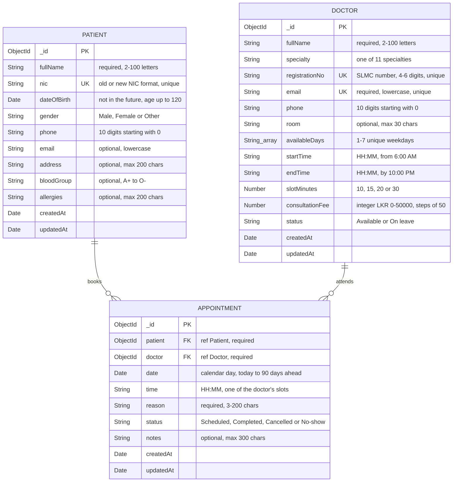

**Keys and indexes**

| Collection | Index | Purpose |
|---|---|---|
| doctors | `registrationNo` (unique); `email` (unique) | No duplicate doctors |
| doctors | `fullName`; `specialty + status` | Default sort; specialty and status filters |
| patients | `nic` (unique) | One record per person |
| patients | `fullName`; `phone` | Default sort; search by phone |
| appointments | `doctor + date + time` (unique while Scheduled) | A doctor cannot be booked twice for the same slot |
| appointments | `patient + date + time` (unique while Scheduled) | A patient cannot be in two places at once |
| appointments | `date + time + status`; `patient + date` | Day lists and status filter; a patient's history |

**Design decisions**

- The two unique indexes are **partial** (only `Scheduled` appointments), so a cancelled slot can be booked again while the cancelled visit stays on record. They are also the final guard if two people book the same slot at the same moment.
- Time slots are not stored. They are worked out from the doctor's hours and slot length, so changing a schedule can never leave old slot records behind.
- Appointment dates are stored as the calendar day at midnight UTC plus a separate `HH:MM` time, so a booking never shifts to another day because of time zones.
- Money is stored as a whole number of rupees, never as a floating-point value.

## Getting started

### Prerequisites

- [Node.js](https://nodejs.org/) 22.9 or newer
- A free [MongoDB Atlas](https://www.mongodb.com/atlas) cluster (or a local MongoDB server)

### 1. Clone and install

```bash
git clone https://github.com/kavihesh/Medical-Appointment-Booking-System.git
cd Medical-Appointment-Booking-System
npm install
```

One `npm install` at the root installs the client, server and shared packages (npm workspaces).

### 2. Configure the database

```bash
cp server/.env.example server/.env
```

Edit `server/.env` and set `MONGODB_URI` to your Atlas connection string, including the database name:

```
MONGODB_URI=mongodb+srv://<user>:<password>@<cluster>.mongodb.net/medical_appointments?retryWrites=true&w=majority
```

In Atlas, add your IP address under **Network Access**.

### 3. Load sample data (optional)

```bash
npm run seed
```

This adds 3 doctors, 3 patients and 3 appointments on the next working days. It refuses to run if the database already has data; `npm run seed:reset` replaces everything.

### 4. Run the app

Open two terminals:

```bash
npm run dev:server   # API on http://localhost:5000
npm run dev:client   # Web app on http://localhost:5173
```

Open http://localhost:5173.

### Other scripts

| Command | Description |
|---|---|
| `npm test` | Runs the validation and API tests |
| `npm run lint` | Runs ESLint on all code (no warnings allowed) |
| `npm run build` | Builds the production front end into `client/dist` |

## REST API

Base URL: `/api`. Request and response bodies are JSON.

| Method | Endpoint | Description |
|---|---|---|
| GET | `/doctors` | List doctors. Query: `q`, `specialty`, `day`, `status`, `sort` (`fullName`, `specialty`, `consultationFee`, `createdAt`), `order`, `page`, `limit` |
| GET | `/doctors/:id` | One doctor with their upcoming appointments |
| GET | `/doctors/:id/slots?date=YYYY-MM-DD` | The doctor's time slots on that day, each `free`, `booked` or `past` |
| POST | `/doctors` | Add a doctor |
| PUT | `/doctors/:id` | Update a doctor (409 if going on leave or a new schedule would strand upcoming appointments) |
| DELETE | `/doctors/:id` | Delete a doctor (409 if they have appointments) |
| GET | `/patients` | List patients. Query: `q`, `gender`, `bloodGroup`, `sort` (`fullName`, `dateOfBirth`, `createdAt`), `order`, `page`, `limit` |
| GET | `/patients/:id` | One patient with their appointment history |
| POST | `/patients` | Register a patient |
| PUT | `/patients/:id` | Update a patient |
| DELETE | `/patients/:id` | Delete a patient (409 if they have appointments) |
| GET | `/appointments` | List appointments. Query: `when` (`today`, `upcoming`, `past`), `date`, `status`, `doctor`, `patient`, `sort` (`date`, `createdAt`, `status`), `order`, `page`, `limit` |
| GET | `/appointments/:id` | One appointment |
| POST | `/appointments` | Book an appointment (checks working day, slot, leave, past times and double booking) |
| PUT | `/appointments/:id` | Reschedule, change status, reason or notes |
| DELETE | `/appointments/:id` | Delete an appointment |

List responses look like `{ items, page, limit, total, totalPages }`. Page size is capped at 50.

Errors always have the same shape, so the UI can show each message next to the right field:

```json
{
  "error": {
    "code": "SLOT_TAKEN",
    "message": "This time is already booked. Choose another slot.",
    "fieldErrors": { "time": "This time is already booked. Choose another slot." },
    "requestId": "1f0c..."
  }
}
```

| Status | When |
|---|---|
| 400 | Invalid input, unknown fields, malformed JSON, bad query parameters, a non-working day, a time that is not a slot or has passed, or a doctor on leave |
| 404 | Record or route not found (including malformed ids) |
| 409 | Duplicate SLMC number, email or NIC, a slot already taken, a patient already booked at that time, or a change blocked by existing appointments |
| 413 | Request body larger than 10 KB |
| 500 | Unexpected error (details are logged on the server, never sent to the browser) |

## Validation and error handling

| Field | Rule |
|---|---|
| Full name | Letters in any script (Sinhala and Tamil included), spaces, dots, apostrophes and hyphens; 2-100 characters |
| SLMC registration no. | 4-6 digits, unique |
| NIC number | 9 digits followed by V or X, or 12 digits; stored in upper case, unique |
| Date of birth | A real date, not in the future, age up to 120 |
| Email | Valid address, stored in lowercase; unique for doctors, optional for patients |
| Phone | 10 digits starting with 0; spaces and dashes typed by the user are removed |
| Working days and hours | At least one day; start from 6:00 AM, end by 10:00 PM, and long enough for at least one appointment |
| Consultation fee | Whole rupees 0-50,000 in steps of 50 |
| Appointment date and time | Today up to 90 days ahead, on the doctor's working day, one of the doctor's free slots, not already passed |
| Reason for visit | 3-200 characters |
| Notes, allergies, address | Optional, with length limits and a live counter |

- **Client:** the forms use the shared Zod schemas. A field is checked when you leave it, re-checked while you fix it, and on Save the first invalid field gets focus. Server errors (for example "This time is already booked") appear under the matching field.
- **Server:** every request body and query string is validated with the same schemas; unknown fields are rejected and bodies are limited to 10 KB. Booking rules are checked again on the server before saving.
- **Database:** Mongoose schemas repeat the rules (required fields, ranges, enums, patterns) and unique indexes stop duplicates and double bookings.
- **Stability:** every page has loading, empty and error states with a retry button; requests time out after 15 seconds; the API never sends stack traces to the browser.

## Testing

- `npm test` runs 16 automated tests: the shared validation rules (9) and the API's validation and error handling (7).
- The booking rules were checked against the live database with a scripted smoke test (double booking, a time that is not a slot, a non-working day, rescheduling, a blocked leave, a blocked delete, and a cancelled slot becoming free again).
- The main user flows were also checked in a real browser at desktop and phone size, including booking through the slot picker.

## Screenshots

| | |
|---|---|
| 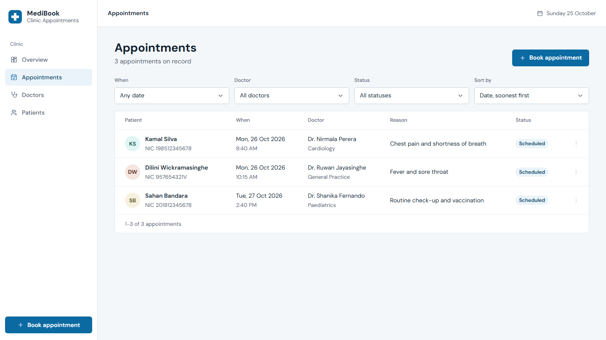 | 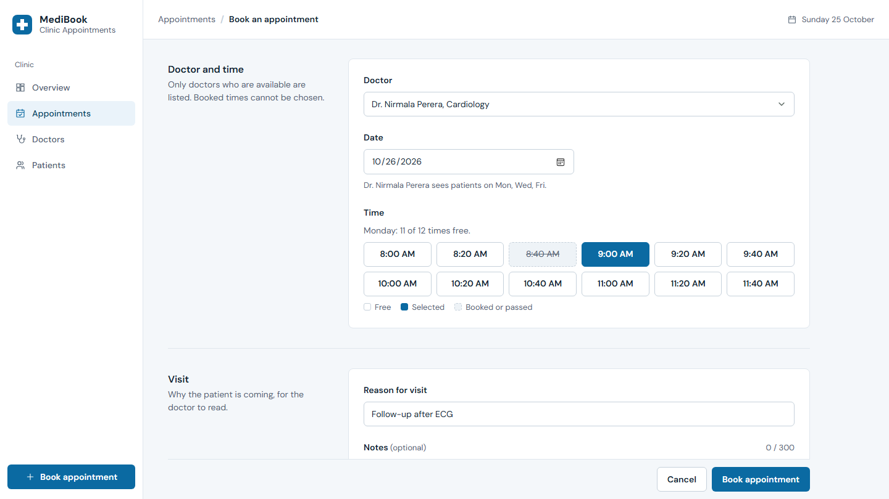 |
| Appointments with filters and sorting | Booking: booked times are crossed out |
| 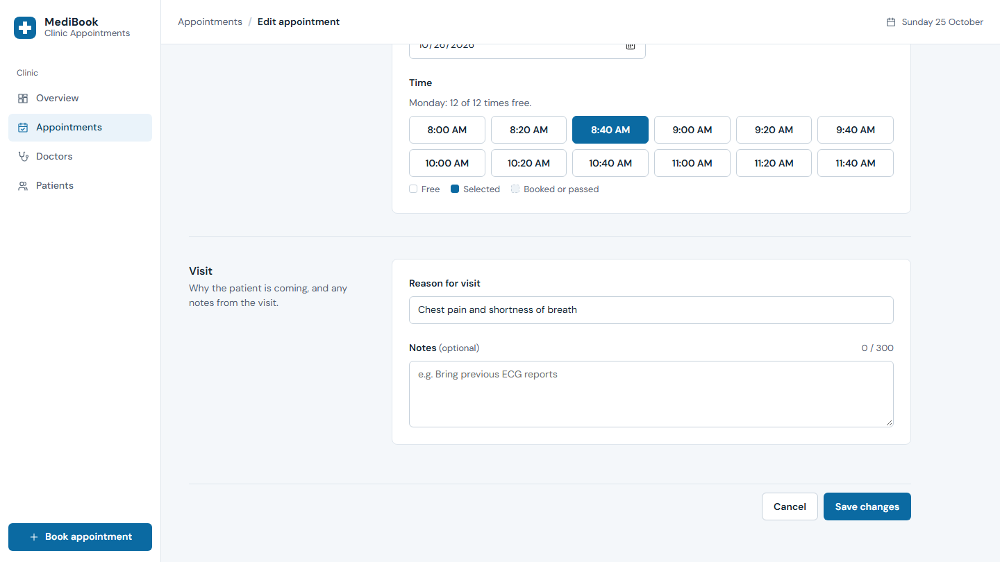 | 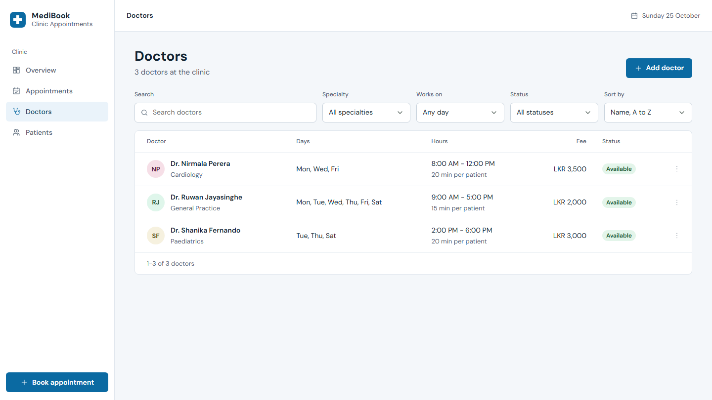 |
| Reschedule or change status | Doctors with search and filters |
| 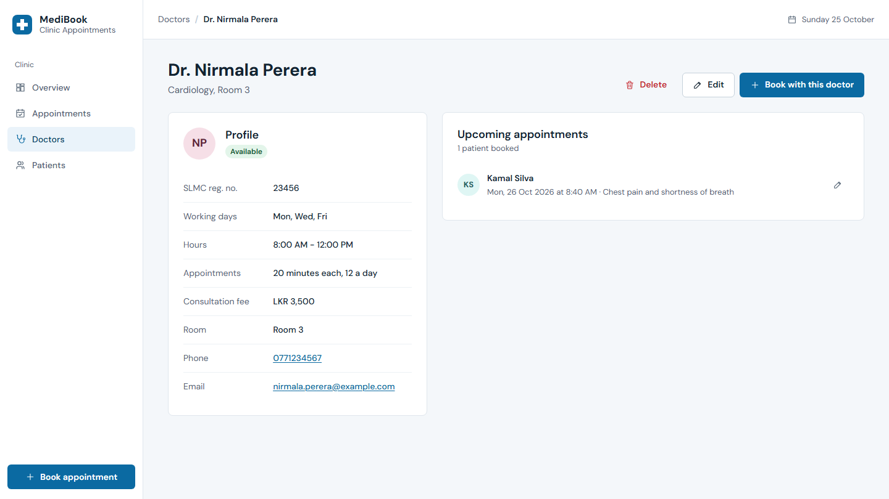 | 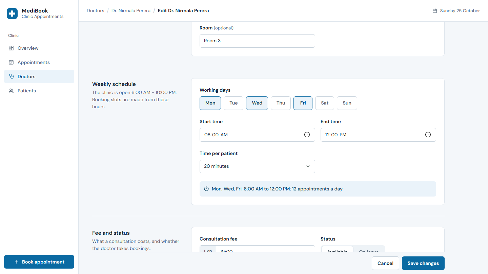 |
| Doctor profile with upcoming appointments | Weekly schedule in the doctor form |
| 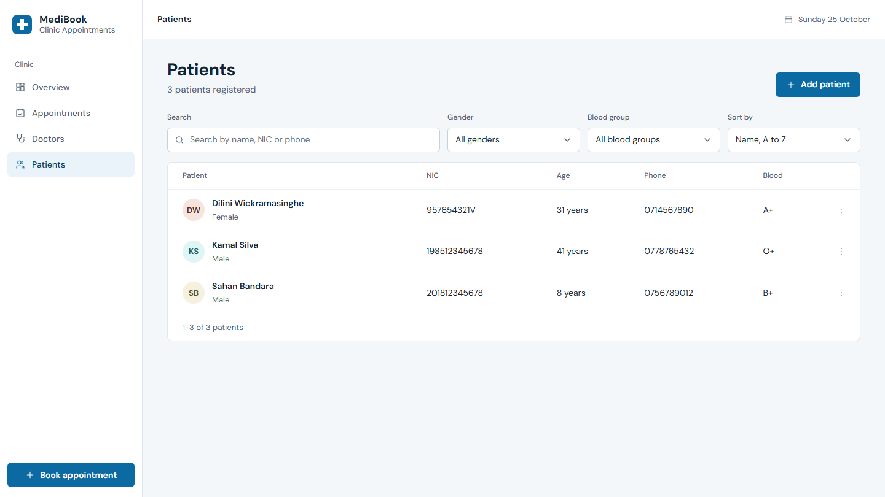 | 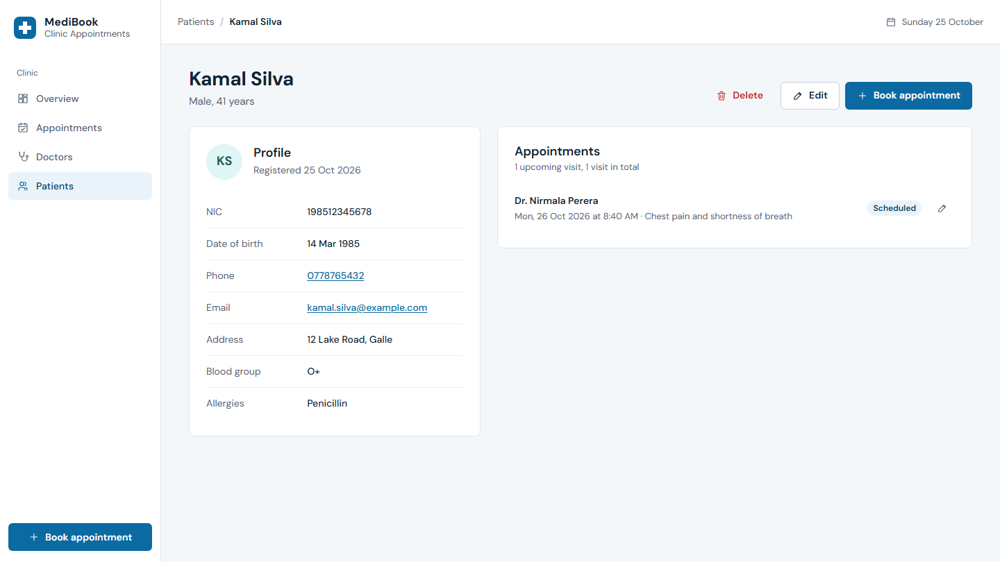 |
| Patients list | Patient profile with visit history |
| 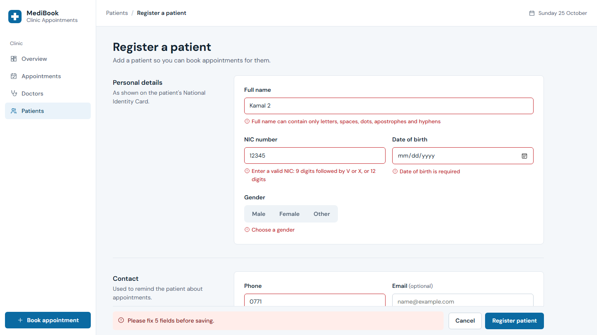 | 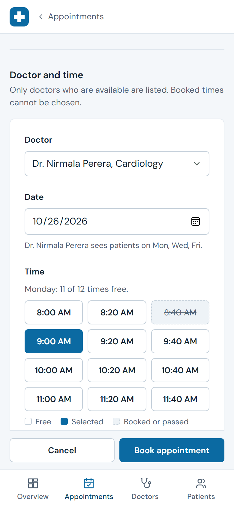 |
| Validation messages under each field | Booking on a phone |

## License

MIT
